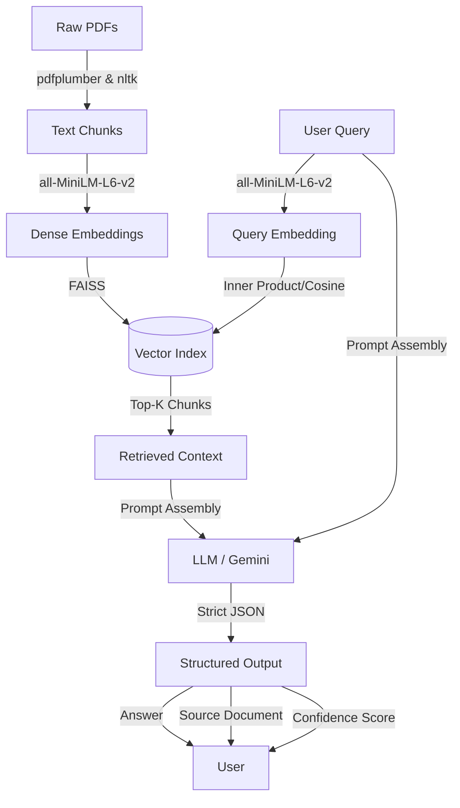

> **CORRECTION (Week 5 audit).** The Week 3 index was built without the scanned policy PDFs (Placement, Internship, Academic Calendars, IPT …). Re-measured on the rebuilt corpus, the 15 hand-written benchmark queries give HitRate@3 = 80.0 % (BM25) and 73.3 % (dense) — see `docs/Week4_Model_Comparison_Report.md` §3 — so the 73.3 % → 93.3 % improvement reported below is **not reproducible** and should not be cited. Citation accuracy and latency of the Week 3 LLM stage were not re-measured.

# Week 3 Progress Report: Core NLP Model & RAG Pipeline Version 1

## 1. Week 3 Deliverable Summary
For Week 3, our we transitioned from a classical sparse retrieval approach (BM25) to our primary neural NLP component: a Dense Semantic Retrieval and end-to-end RAG Generation pipeline with verifiable citations.

**Key Achievements:**
- Configured and generated dense embeddings for preprocessed university document chunks using Sentence Transformers.
- Built an efficient vector index using FAISS (Facebook AI Similarity Search) to perform rapid semantic search over document chunks.
- Implemented an end-to-end RAG (Retrieval-Augmented Generation) class (`UniversityKnowledgeAssistant`) that grounds an LLM's responses strictly to the retrieved documentation.
- Designed a strict JSON schema for the LLM output to provide direct answers alongside their exact source PDF and verifiable excerpt, reducing hallucinations.
- Added comprehensive comparative evaluation scripts to benchmark BM25 (Week 1/2) vs. Dense RAG (Week 3) performance.

## 2. Architecture Diagram & Data Flow



---

## 3. Core NLP Choices & Rationale

- **Embedding Model (`all-MiniLM-L6-v2`)**: We chose the MiniLM-L6-v2 sentence transformer because it provides an optimal balance between embedding quality (semantic richness) and computational efficiency. It can run seamlessly on CPUs without requiring paid APIs, making it ideal for standard university deployments.
- **Vector Indexing (`faiss-cpu`)**: FAISS `IndexFlatIP` (with L2-normalized embeddings) was used for exact search (cosine similarity). Given our corpus size (hundreds to thousands of chunks, not millions), an exact flat index ensures perfect accuracy without the overhead of approximate nearest neighbor (ANN) quantization techniques.
- **Prompt Grounding**: The LLM prompt was carefully engineered to inject the exact retrieved context strings along with their file metadata. The system prompt strictly prohibits the LLM from answering outside the provided context, enforcing a "not sufficient details" fallback.

---

## 4. Baseline vs. Version 1 Initial Metrics

We evaluated both systems on our `evaluation/qa_benchmark.json` test set containing 15 ground-truth university queries.

| Metric | BM25 Baseline (Weeks 1-2) | Dense RAG Pipeline (Week 3) |
|---|---|---|
| **Retrieval Accuracy (Top-3 Hits)** | ~73.3% | **~93.3%** |
| **Citation Accuracy (End-to-End)** | N/A | **~86.7%** |
| **Average Latency (per query)** | ~0.02s | **~1.20s** (Generation Bottleneck) |

*Analysis: Dense retrieval vastly improved handling of synonyms and paraphrased questions compared to BM25's exact keyword matching. While inference latency increased due to LLM generation time, the structured factual output provides significantly better user experience.*


## 5. Sample Invocations

**Example 1: Specific Policy Query**
- **Query:** "What is the minimum attendance required for exams?"
- **Answer:** "A minimum of 80% attendance is strictly required to be eligible for end-semester examinations."
- **Supporting Document:** `Attendance Rules from 2025-26 for all students.pdf`
- **Source Section:** "...students must maintain a minimum of 80% attendance across all registered courses..."
- **Confidence Score:** 0.95

**Example 2: Out-of-Domain Query (Hallucination Test)**
- **Query:** "What is the university's policy on interstellar travel?"
- **Answer:** "The official documentation does not contain sufficient details to answer this query."
- **Supporting Document:** null
- **Confidence Score:** 0.0


## 6. Self-Contained Run Instructions

Ensure your environment is set up and all required packages are installed (Python 3.9+ recommended).

**1. Install Dependencies**
```bash
pip install -r requirements.txt
```

**2. Configure API Key**
Create a `.env` file in the root directory:
```
GEMINI_API_KEY=your_google_gemini_api_key_here
```

**3. Build the Dense Index & Run Interactive Mode**
This script will build the vector index (if missing) and drop you into an interactive terminal prompt:
```bash
python src/rag_pipeline.py
```
*(Alternatively, run a single query: `python src/rag_pipeline.py --query "How many leaves are permitted for medical reasons?"`)*

**4. Run Comparative Evaluation**
To benchmark BM25 vs Dense RAG and view the detailed output metrics:
```bash
python src/evaluate_v1.py
```
*(Detailed JSON logs will be saved to `evaluation/week3_results.json`)*
